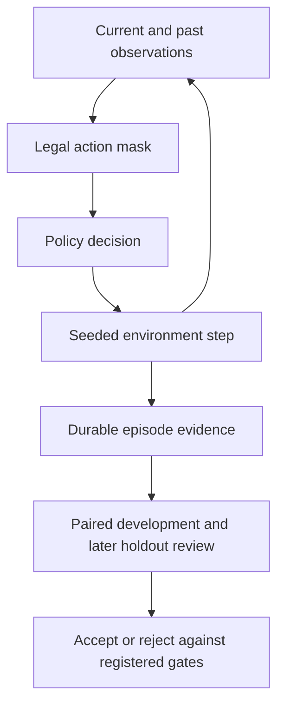

# Kaggriculture · Sequential decision systems

**Legal observations. Paired experiments. Decisions backed by evidence.**

[](https://github.com/alvaromendizabal/kaggriculture/actions/workflows/quality.yml)
[](https://github.com/alvaromendizabal/kaggriculture/actions/workflows/public-demo.yml)


[**Open the farming lab ↗**](https://alvaro-farming-agent-lab.tartmacaw2.chatgpt.site) · [Case study](CASE_STUDY.md) · [Executed project review](notebooks/57_portfolio_review.ipynb) · [Run and verify](docs/REPRODUCIBILITY.md)

I built and evaluated farming agents under changing opponents. My work spans legal-observation feature audits, policy integration, chronological validation, paired simulation, and recovery of expensive completed experiments.

The decisive finding was an evaluation mismatch: an incumbent that looked nearly perfect against a fixed local panel recorded **18 wins / 10 ties / 20 losses** on a more recent 48-episode panel. The corrected **47.9% win/tie score** changed the promotion decision. The project demonstrates how to identify a misleading validation setup and preserve the evidence behind a rejected change. [Recorded experiment](reports/final_sprint_2026-09-30.json)

## Inspect the work

| Question | Best starting point |
|---|---|
| What problem did the system solve? | [Case study](CASE_STUDY.md): constraints, implementation, results and limitations |
| How does an agent choose legal actions? | [Observation audit](src/kaggriculture_research/audit.py) and [foundation tests](tests/test_foundation.py) |
| What prevented an unsupported promotion? | [Final-sprint review logic](src/kaggriculture_review/final_sprint.py) and [registered protocols](docs/research/final_sprint_protocols.md) |
| How does completed computation survive interruptions? | [Artifact layer](src/kaggriculture_research/artifacts.py) and [checkpoint integrity tests](tests/test_foundation.py) |
| Can I verify something locally? | The dependency-free command below and [source-linked review](review/README.md) |

## Run a verified public review

With Python 3.11+ and Node.js 22 or 24:

```bash
python3 -S review/run.py --output /tmp/kaggriculture-review --with-node
python3 -S review/run.py --output /tmp/kaggriculture-review --with-node --check
```

Open `/tmp/kaggriculture-review/index.html`. The bundle records source hashes, actual command outcomes and elapsed times. The second command verifies the saved result. On Windows, choose a writable directory outside the checkout. Omit `--with-node` for the smaller Python-only evidence path.

This public path validates aggregate research evidence and exercises the educational simulator. It requires no package installation, cloud account, competition data or private policy. The [locked Python environment](docs/REPRODUCIBILITY.md) supports the wider research checks and notebook execution.

## Explore the farming lab

```bash
python -m http.server 8000
```

Open `http://localhost:8000/public-demo/`. Plant, water, harvest, sell or work through a 24-day season. Inspect each legal observation and the policy's explanation. Three fixed educational policies run under identical weather and prices for each comparison seed.

The comparison shows **matched wins, ties and losses**, the range of paired changes, and a table of every seed. A positive average can coexist with losing seasons. This makes the comparison's downside visible without treating eight visible synthetic seeds as an independent benchmark.

The lab is an authored educational surrogate. Its mechanics and outcomes are separate from official Kaggriculture measurements and the private agent.

### Replay your browser export

```bash
node tools/replay_public_demo.mjs --input field-notes-evidence.json --output /tmp/farming-replay
node tools/replay_public_demo.mjs --output /tmp/farming-replay --check
```

The verifier reconstructs every observation, policy choice, manual action, resource balance and paired outcome with the shipped engine. Omit `--input` to generate a reference run. [Replay contract](docs/DEMO_REPLAY.md)

## System design



The seed defines an evaluation environment; it never enters the policy observation. Training episodes determine learned screens and policy selection. Both seats of a seed remain together, and later holdout episodes remain separate. [Recorded evaluation protocol](docs/research/final_sprint_protocols.md)

## Recorded results and decisions

| Evidence | Result | Interpretation |
|---|---:|---|
| Recent local panel | **18 W / 10 T / 20 L**, 48 episodes | 47.9% win/tie score exposed weak transfer from the saturated fixed panel |
| Chronological evaluation | **24 development + 24 later holdout episodes** | Selection and confirmation populations are distinguished |
| Reused computation | **1,084 accepted branch/calibration results** | Completed results reused without replaying games |
| Historical rating snapshot | **2048.7** strongest returned project submission | An official rating snapshot, separate from local match statistics |
| September 30 latest-two ratings | **1691.0 / 1516.2** | Later historical snapshots; no new rating claimed by this release |

[Executed review](notebooks/57_portfolio_review.ipynb) · [Source-linked interpretation](CASE_STUDY.md) · [Final-sprint evidence](reports/final_sprint_2026-09-30.json)

The 48-episode sample is small and dated. Recorded opponent tapes cannot react to changed actions. A native harvest/service experiment stopped during diagnostics, so its scientific outcome remains unresolved. Failed promotion gates and diagnostic transport failures are preserved as different kinds of evidence.

## Repository map and release scope

| Location | Purpose |
|---|---|
| `public-demo/`, `tools/` | Educational simulator, paired diagnostics and export replay |
| `src/`, `scripts/`, `tests/` | Maintained research components, execution and validation |
| `notebooks/`, `reports/` | Executed reviews and compact aggregate evidence |
| `docs/`, `review/` | Protocols, source attribution and reproducibility instructions |

The public tree contains the final evaluation contracts and their evidence, not the historical experiment workspace. Superseded crop, livestock, staffing, market, terminal and adaptive-policy studies, their launchers, copied notebooks and intermediate outputs have been retired. Compact negative results remain only where they explain the final decision.

Raw replay corpora, private checkpoints, credentials, submission archives and the exact private agent remain outside this release. Public source and compact evidence are sufficient for the documented component checks; they do not recreate the private competitive system. [Source credits](docs/public_source_lineage.md)
