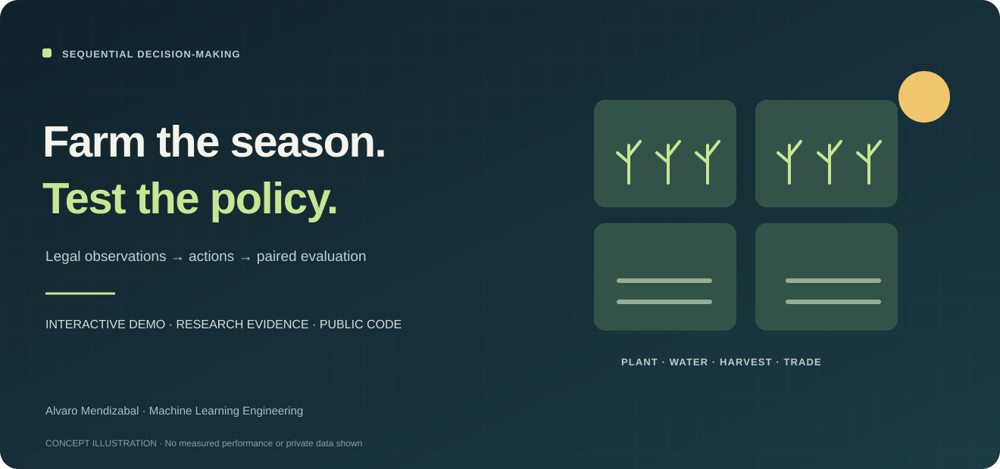

# Kaggriculture · Sequential Decision-making and Evaluation

**Alvaro Mendizabal · Agent systems · Simulation · Experimental design · AWS engineering**



I built and evaluated farming agents under changing opponents. My work covers legal-observation feature audits, policy integration, paired comparisons, chronological validation and restartable simulation infrastructure.

**Engineering ownership:** I developed the observation audits, policy-integration workflow, experimental protocols and recovery controls. The public implementation makes legal actions, policy behavior and paired evaluation inspectable; the research record shows how those checks informed selection decisions.

The most consequential finding was a validation mismatch: an incumbent that looked nearly perfect against a fixed local panel recorded **18 wins / 10 ties / 20 losses across 48 recent episodes**, a **47.9% win/tie score**. I corrected the evaluation protocol instead of promoting policies on the saturated panel.

**Start here:** [Farming Decision Lab](https://alvaro-farming-agent-lab.tartmacaw2.chatgpt.site) · [Case study](CASE_STUDY.md) · [Three-minute review](docs/REVIEWER_GUIDE.md) · [Run locally](docs/REPRODUCIBILITY.md)

## Try the Farming Decision Lab

[Open the live lab](https://alvaro-farming-agent-lab.tartmacaw2.chatgpt.site), or run the same source locally:

```bash
python -m http.server 8000
```

Open `http://localhost:8000/public-demo/`. Play a 24-day season across four plots: plant, water, harvest, sell or work. Inspect which actions are legal, then compare three generic policies under identical seeded weather and price sequences. Decisions and outcomes are computed in the browser and can be inspected without an account or private agent.

This is an authored educational farming surrogate. It illustrates observation boundaries and paired evaluation; its mechanics and outcomes are not official Kaggriculture measurements.

```bash
node tools/test_public_demo.mjs
```

## What I built and learned

| Capability | Evidence and decision |
|---|---|
| Evaluation aligned to observed behavior | Exact terminal-reward reconstruction before testing changed policies |
| Chronological selection | Older 24-episode development set and newer 24-episode holdout kept separate |
| Efficient counterfactual research | **1,084** accepted branch/calibration results reused without replaying games |
| Promotion discipline | Transfers and intervention policies rejected when registered gates failed |
| Failure-aware execution | Post-game diagnostic transport failure recorded separately from a scientific result |

Recorded official ratings are historical snapshots. The strongest returned project submission was **2048.7**; the September 30, 2026 latest-two pair was **1691.0 / 1516.2**. These ratings are separate from local win/tie scores and the new synthetic demo. No new rating is claimed by this release.

## Review the research

[Case study](CASE_STUDY.md) · [Executed portfolio notebook](notebooks/57_portfolio_review.ipynb) · [Registered research protocols](docs/research/final_sprint_protocols.md) · [Public release closeout](docs/PROJECT_CLOSEOUT.md)

The corrected 48-episode sample is small and dated. Recorded opponent tapes cannot react to changed actions, so responsive-opponent tests remain a separate requirement. The native harvest/service experiment stopped during diagnostics; its scientific outcome is unresolved.

## Run public Python checks

Use Python 3.12 and the committed environment:

```bash
uv sync --frozen
uv run pytest -q tests/test_final_sprint.py
uv run python scripts/verify_final_sprint.py
python3 scripts/verify_portfolio_review.py
python3 examples/run_demo.py
```

These commands validate aggregate evidence and run the existing synthetic paired-outcomes example. They do not launch private competitive games or submit an agent. [Run and verify this project](docs/REPRODUCIBILITY.md)

## Publication boundary

The portfolio contains public code, executed notebooks, protocols, aggregate results and an interactive synthetic demo. Raw replay corpora, private checkpoints, credentials, submission archives and the exact private agent remain excluded. Upstream controllers and methods retain their [source credits](docs/research/leading_solution_reproduction_matrix.md).
